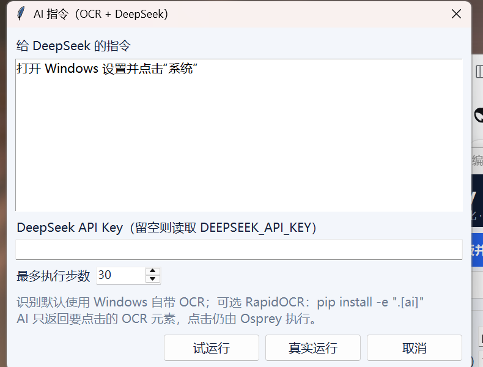

# Osprey

**English** | [简体中文](README.zh-CN.md)

**Screen-vision automation for Windows.** Capture the screen, find targets with
template matching, then act through synthesised keyboard and mouse input.

Osprey is a small, readable engine and library rather than a framework you have
to adopt wholesale. The core is plain Python on top of NumPy, Pillow and the
Win32 API.

Status: **1.0.1 alpha**, Windows 10/11, Python 3.9+.

## Why this exists

Most desktop automation finds controls by name through UI Automation or the
accessibility tree. That breaks for games, custom-drawn interfaces, remote
desktops and anything painted onto a canvas. Osprey takes the other route:
look at pixels, decide, act.

The architecture follows projects such as BetterGenshinImpact - capture, vision,
decision, input - but stays focused on the engine rather than any single game.

## What it is, and what it is not

It is:

- a library and CLI for pixel-driven automation on Windows;
- a tested normalised-cross-correlation matcher with multi-scale search, a
  coarse-to-fine pyramid and an optional OpenCV fast path;
- a visual editor for click sequences, with template capture, step duplication
  and dry/live runs;
- a runner that is safe by default: dry runs, a panic key, a stop file and a
  runtime cap.

It is not:

- a memory reader, DLL injector or packet manipulator;
- an OCR or LLM agent - vision is template matching, and OCR belongs in your task;
- a tool for faking attendance, exams or any other academic credit. See
  **Responsible use**.

## Features

| Area | What you get |
|---|---|
| Capture | GDI DIB-section capture, ~40 ms for 2560x1600, region capture, per-monitor DPI awareness, all monitors as one frame |
| Matching | FFT normalised cross-correlation, multi-scale, coarse-to-fine pyramid, NMS, OpenCV optional |
| Input | SendInput scan codes, absolute mouse over the virtual desktop, humanised Bezier movement, Unicode typing |
| Actions | Click, move, wait, key press and drag (slide/swipe) |
| Engine | Fixed-FPS loop, duration cap, panic key, stop file, graceful teardown, statistics |
| Safety | Dry run by default, F12 abort anywhere, held keys/buttons released on exit |
| Editor | Drag-to-capture templates, reorder/edit steps, add a drag step, **duplicate a step**, dry and live runs |
| Plans | Declarative JSON plans with per-step waits, thresholds, timeouts, scales and drag points |
| AI | OCR + DeepSeek text-API agent; built-in Windows OCR, optional RapidOCR |
| API | Tiny Task interface: setup / step / teardown, plus a small state machine |
| Packaging | Self-extracting Windows setup, portable zip, no Python required |

## Install

### Windows installer (no Python required)

Download **Osprey-1.0.1-Setup.exe** from
[Releases](https://github.com/wazgf1f/osprey/releases).

The installer shows the terms of use first: you must tick "I have read and
agree" to continue, and the install path is customisable. It installs to
<code>%LOCALAPPDATA%\Programs\Osprey</code> and adds Desktop and Start Menu
shortcuts.

- **Upgrades:** from 1.0.1 the installer extracts to a staging directory and
  replaces the existing installation, so old files do not survive an update.
  Close Osprey before installing a new version.
- **Uninstall:** Settings -> Apps -> **Osprey 1.0.1**, or run
  <code>uninstall.bat</code> from the install directory.
- **SmartScreen:** the executable is unsigned, so Windows may warn about an
  unknown publisher. Choose **More info**, then **Run anyway**.

The terms state that this software must not be used for attendance fraud,
watch-time farming or any other academic dishonesty, and that the user accepts
all consequences of use.

### Portable

Unzip **Osprey-1.0.1-win64-portable.zip** and run <code>osprey.bat</code>.

### From source

    git clone https://github.com/wazgf1f/osprey.git
    cd osprey
    python -m venv .venv
    .venv\Scripts\activate
    pip install -e .

Optional, typically 5-10x faster matching on large screens:

    pip install -e ".[opencv]"

Windows is required for screen capture and input. The vision and configuration
modules import fine on other platforms, which is what CI uses.

Read [DISCLAIMER.md](DISCLAIMER.md) before use.

## Quick start

### Visual editor (recommended)

    osprey gui

1. Click **框选模板并添加点击** (capture a template and add a click). The editor
   captures all monitors, dims the desktop and lets you drag a box around the
   target. The crop is saved under <code>assets/</code> next to the plan.
2. Add more steps with **添加点击 / 添加等待 / 添加按键**.
3. For a swipe or drag, click **添加滑动** and set the start point, end point
   (desktop coordinates), duration and mouse button. The engine presses at the
   start, glides to the end with a humanised path, then releases.
4. Select a step and click **复制步骤**, or press **Ctrl+D**, to duplicate it.
   The copy is inserted directly below the original and keeps its template,
   waits, threshold, timeout, per-step scales and drag points. The two steps are
   independent, so editing the copy does not change the original.
5. Reorder with **上移 / 下移**, or edit a step with **编辑**.
6. Set the plan name, loop count, threshold and scales at the top.
7. Use **试运行** (dry run) first, then **真实运行** (live run). **F12** stops a
   run; **停止** also works.
8. **保存** writes a JSON plan. Run it later with <code>osprey play plan.json</code>.

The editor locks its editing buttons while a run is active, and releases held
keys if you close it during a live run.

### Command line

Check the environment first:

    osprey doctor

    osprey 1.0.1
    python      : 3.12.14
    platform    : Windows-11-10.0.26300-SP0 (AMD64)
    numpy       : 2.3.5
    pillow      : 12.3.0
    opencv      : not installed (numpy backend will be used)
    dpi aware   : True
    dpi scale   : 1.500x
    monitor 0   : 2560x1600 at (0, 0)  [primary]
    screen      : 2560x1600 at origin (0, 0)
    capture ms  : min 35.1  mean 41.4  max 47.3
    brightness  : 151.1 (0 means a black or locked screen)
    input       : ok (cursor moved and was restored)
    status      : ready

If doctor reports **input BLOCKED**, the desktop refuses synthetic input - some
RDP sessions, sandboxes and secure desktops do. Capture and dry runs still work;
only live input is unavailable.

Capture and match:

    osprey grab shot.png
    osprey find examples/assets/target.png --save marked.png
    osprey crop tasks/assets/accept.png --region 900,500,220,64

The find output contains frame-relative coordinates and the desktop coordinate:

    x=1476 y=814 w=64 h=64 score=1.0000 scale=1.000 desktop=(1476,814)

Use the <code>desktop=(x, y)</code> value when clicking.

### AI instruction box (OCR + DeepSeek)

The editor has an **AI 指令…** button. It opens a dialog with a multi-line text
box for the goal, an optional DeepSeek API key and a step limit.

1. Set <code>DEEPSEEK_API_KEY</code> in the environment or paste a key into the
   dialog. The dialog key is used for that run only and is not saved.
2. Click **AI 指令…**, type an instruction such as
   "open Windows Settings and click System".
3. Use **试运行** first, then **真实运行**. The editor minimises itself so
   OCR sees the whole desktop instead of the Osprey window. **F12** stops the
   agent.
4. OCR uses the Windows 10/11 built-in engine, so the installed app needs no
   extra Python packages. Install <code>.[ai]</code> for an optional RapidOCR
   backend.

The same agent runs from the CLI:

    set DEEPSEEK_API_KEY=sk-...
    osprey run examples/ai_agent.py --config examples/ai_agent.json --live

The model receives OCR text boxes, not screenshots. It only chooses an element
id; Osprey performs the click through the normal input layer.

### Plan file

The editor writes plans like this. Relative template paths are resolved against
the plan file's directory.

    {
      "name": "daily",
      "threshold": 0.86,
      "timeout": 8,
      "fps": 6,
      "loop": 1,
      "on_missing": "stop",
      "scales": [1.0, 1.25],
      "steps": [
        {
          "action": "click",
          "template": "assets/accept.png",
          "wait": 1.0,
          "timeout": 5,
          "threshold": 0.9,
          "scales": [1.0, 1.25]
        },
        {"action": "wait", "seconds": 0.8},
        {"action": "press", "key": "enter", "wait": 0.5},
        {"action": "drag", "from": [300, 400], "to": [900, 400],
         "duration": 0.5, "wait": 0.3}
      ]
    }

## Live demo

    python tools/make_target.py
    start examples\assets\target.png
    python examples/click_demo.py
    python examples/click_demo.py --live

The demo finds the target card, reports its desktop position and clicks it once.
Press **F12** to stop at any time.

## Writing a task

A task owns the decisions; the engine owns capture, timing, safety and teardown.

    # tasks/accept.py
    from osprey.core.task import Task

    class AcceptMatch(Task):
        name = "accept-match"

        def setup(self, ctx):
            self.template = "accept.png"   # resolved against assets_dir
            self.clicks = 0

        def step(self, ctx):
            button = ctx.locate(self.template, threshold=0.88)
            if button is None:
                return
            ctx.click(button)
            self.clicks += 1
            ctx.sleep(0.6)
            if self.clicks >= 3:
                ctx.safety.request_stop("done")

    {
      "threshold": 0.88,
      "scales": [1.0, 0.9, 1.1],
      "fps": 5,
      "assets_dir": "tasks/assets",
      "max_runtime": 300
    }

    osprey run tasks/accept.py --config tasks/config.json
    osprey run tasks/accept.py --config tasks/config.json --live

A module with exactly one Task subclass is loaded automatically. With several,
expose <code>TASK</code> or <code>create_task()</code> so the CLI knows which one to run.

Everything a task touches hangs off the context:

| Member | Meaning |
|---|---|
| <code>ctx.frame</code> | Current BGRA frame with its desktop origin |
| <code>ctx.gray</code> | Luma view, computed once per frame |
| <code>ctx.locate(template, roi=..., scales=...)</code> | Best detection or <code>None</code> |
| <code>ctx.locate_all(...)</code> | Every detection above threshold |
| <code>ctx.wait_for(template, timeout=10)</code> | Block until something appears |
| <code>ctx.click(target)</code> | Click a detection or a frame-relative point |
| <code>ctx.drag(start, end, duration=0.35, button="left")</code> | Press, glide and release a swipe |
| <code>ctx.move(target)</code> | Glide the cursor there |
| <code>ctx.sleep(seconds)</code> | Abortable sleep |
| <code>ctx.snapshot(path)</code> | Save the current frame for debugging |
| <code>ctx.safety</code> | Stop conditions and <code>request_stop()</code> |

## CLI reference

| Command | Purpose |
|---|---|
| <code>osprey doctor</code> | Check Python, dependencies, DPI awareness, capture latency and brightness |
| <code>osprey grab OUT.png [--region x,y,w,h] [--all-screens]</code> | Save a screenshot |
| <code>osprey crop OUT.png --region x,y,w,h</code> | Save a screen region as a template |
| <code>osprey gui [PLAN.json]</code> | Visual editor for click sequences |
| <code>osprey play PLAN.json [--live] [--loop N]</code> | Run a saved sequence |
| <code>osprey find TEMPLATE [--threshold T] [--scales 1.0,0.9] [--all-screens] [--save OUT.png]</code> | Locate a template on the live screen |
| <code>osprey run TASK.py [--config C] [--live] [--fps N] [--duration S]</code> | Run a task |

Only <code>--live</code> sends real input. Without it the run is a dry run:
detections are computed, actions are logged, nothing is clicked.

## Configuration

| Key | Default | Meaning |
|---|---|---|
| <code>threshold</code> | 0.82 | Minimum NCC score, 0..1 |
| <code>scales</code> | <code>[1.0]</code> | Template scales to try |
| <code>nms_iou</code> | 0.3 | Overlap above which detections merge |
| <code>fps</code> | 8 | Loop rate |
| <code>dry_run</code> | true | Never send input |
| <code>abort_keys</code> | <code>["f12"]</code> | Panic keys, polled globally |
| <code>stop_file</code> | null | Run stops when this path exists |
| <code>max_runtime</code> | null | Hard cap in seconds |
| <code>speed</code> | 1.0 | Input speed multiplier |
| <code>move_mode</code> | absolute | <code>absolute</code> or <code>relative</code> mouse motion |
| <code>assets_dir</code> | . | Base directory for relative template paths |
| <code>all_screens</code> | false | Capture every monitor instead of the primary one |

Unknown keys are allowed, so a task can carry its own settings in the same file.

## Architecture

    screen --GDI--> Frame(BGRA) --luma--> matcher --> Detection
                                             |
                                        task.step(ctx)
                                             |
                        ctx.click / key --> SendInput --> desktop

| Module | Responsibility |
|---|---|
| <code>osprey.capture</code> | GDI DIB-section grabber, <code>Frame</code> container |
| <code>osprey.vision</code> | NCC matcher, pyramid, NMS, image IO, overlays |
| <code>osprey.input</code> | SendInput keyboard and mouse, humanised paths, dry run |
| <code>osprey.core</code> | Engine loop, Task API, Context, Safety, plan and configuration |
| <code>osprey.cli</code> | <code>doctor</code>, <code>grab</code>, <code>crop</code>, <code>find</code>, <code>gui</code>, <code>play</code>, <code>run</code> |

More detail, including the matching maths and coordinate model, is in
[docs/architecture.md](docs/architecture.md).

## Resolution, DPI and monitors

Nothing in Osprey is tied to a resolution. Frame size, origin and click targets
are all derived from the desktop at run time.

- The process enables per-monitor DPI awareness, so pixels, <code>GetSystemMetrics</code>
  and cursor coordinates agree. Without it a 150% display reports 1707x1067 for
  a 2560x1600 panel and every click lands in the wrong place.
- Capture buffers are rebuilt automatically if the resolution or monitor layout
  changes mid-run. A region that no longer fits raises a clear error instead of
  silently capturing the wrong area.
- The editor captures every monitor and runs plans with <code>all_screens</code>,
  so templates on a secondary display work. A monitor to the left of the primary
  has a negative origin; the overlay is placed with Win32 <code>SetWindowPos</code>
  because Tk reads negative geometry offsets as distances from the right edge.
- <code>osprey doctor</code> prints the DPI scale, every monitor and the virtual desktop.
- <code>--all-screens</code> captures every monitor as one frame. Input always
  addresses the whole virtual desktop; <code>move_mode: "relative"</code> is there
  for engines that ignore absolute moves.

### Templates across display scaling

A template is pixels, so Windows scaling changes its apparent size: a button
captured at 100% appears 1.5x larger at 150%. Two ways to stay accurate:

1. **Capture on the target machine** with <code>osprey crop</code> or the editor
   (recommended). The template then matches at whatever scaling that machine uses.
2. **Search a scale range** when sharing templates between machines, for example
   <code>--scales 1.0,1.25,1.5</code> or the equivalent <code>scales</code> list in a plan.

## Performance

Measured on the development machine (Windows 11, 2560x1600, Python 3.12,
NumPy 2.3.5, no OpenCV):

| Operation | Time |
|---|---|
| GDI capture | 35-47 ms |
| Match 56x56 template, pyramid enabled | 99-118 ms |
| Match 56x56 template, full resolution | ~381 ms |

The matcher runs in the frequency domain, so cost grows with frame area. Three
knobs keep it practical:

1. **ROI**: <code>ctx.locate(template, roi=(x, y, w, h))</code> searches a rectangle
   instead of the whole screen.
2. **Pyramid**: enabled automatically above one megapixel; <code>downscale=2</code>
   or <code>4</code> forces it, <code>downscale=1</code> disables it.
3. **OpenCV**: <code>pip install -e ".[opencv]"</code> switches to
   <code>matchTemplate</code>, typically 5-10x faster.

## Safety

- **Dry run is the default.** Input is logged, not sent.
- **F12 aborts** anywhere, even while a task is sleeping, because it is polled
  with <code>GetAsyncKeyState</code>.
- **Stop file**: create the configured file and the run ends at the next check.
- **Runtime cap**: <code>max_runtime</code> bounds any run.
- **Release on exit**: held keys and buttons are released during teardown,
  including after an abort.
- **Editor safety**: editing is disabled during a run; closing the editor during a
  live run releases held keys.
- Osprey does not require administrator rights.

## Limitations

- Template matching is sensitive to scale, rotation and transparency. Use
  <code>scales</code>; rotation and masks are not implemented yet.
- Windows only. Capture and input are Win32-specific.
- The secure desktop (UAC prompt, lock screen) captures as black.
- Some environments reject synthetic input entirely (certain RDP sessions,
  sandboxes, locked-down kiosks). Run <code>osprey doctor</code> first.
- Games using raw input or kernel anti-cheat may ignore synthetic input, or may
  detect it.
- No OCR, no text understanding, no scene graph.

## Responsible use

Use Osprey only on systems you own or are authorised to automate.

Automating a game or online service generally violates its terms of service, and
anti-cheat systems are built to detect synthetic input. You can lose an account
over it; that is your call, not the project's.

**Osprey is explicitly not intended for academic fraud.** Do not use it to fake
attendance, watch-time, participation or assessment. Contributions whose purpose
is to defeat attendance or exam checks will be rejected.

The authors accept no liability for misuse or for consequences of running this
software.

## Development and tests

    python -m unittest discover -s tests -t . -v
    python tools/selftest.py

The suite covers the matcher against a brute-force reference, the pyramid against
full-resolution results, input encoding, plan and configuration validation, the
engine loop, safety guards, the editor smoke tests and live capture (skipped
outside Windows). Current suite: 159 tests.

Layout:

    src/osprey/        library and CLI
    tests/             unittest suite
    examples/          runnable examples and demo assets
    tools/             maintenance scripts (selftest, target generator)
    docs/              architecture notes, quickstart and images
    packaging/         PyInstaller entry point and installer builder

Build the Windows installer with <code>packaging/build_installer.py</code>; see
[docs/BUILD.md](docs/BUILD.md).

## Roadmap

- Masked matching for transparent icons
- OCR hook with a pluggable engine
- Debug overlay showing detections live
- X11 backend for Linux
- OpenCV backend parity tests in CI
- Signed Windows builds

## License

MIT. See [LICENSE](LICENSE).

Osprey is not affiliated with miHoYo, HoYoverse or any game publisher.

Author: **Zhaorui Chen**.
