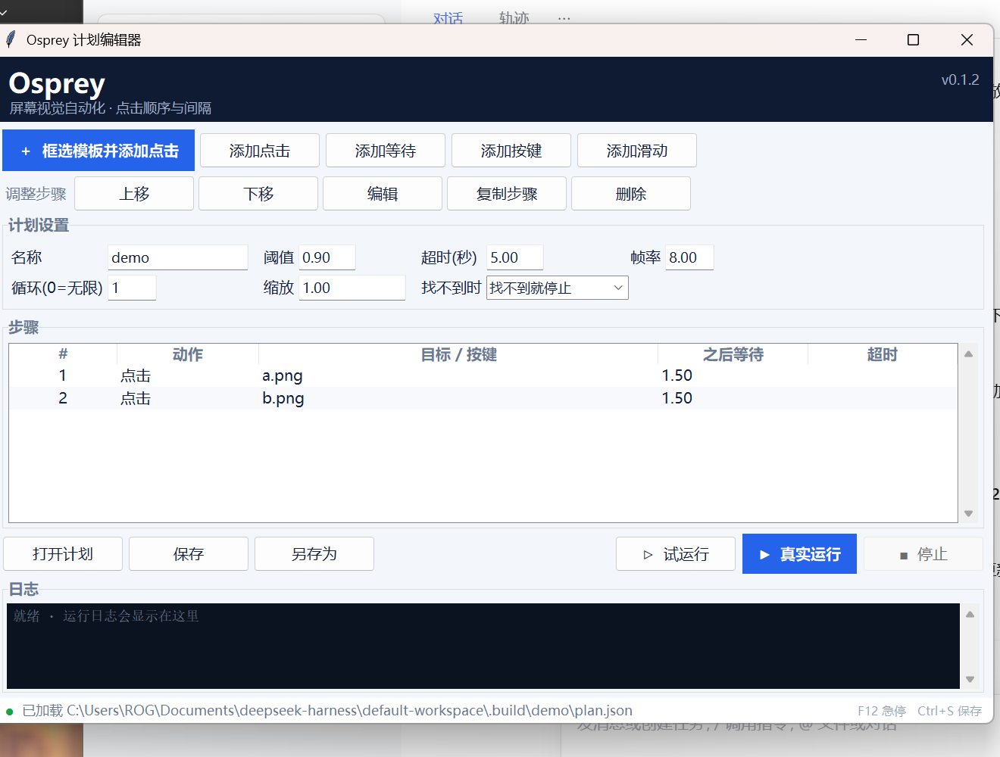

# Osprey（鱼鹰）

[English](README.md) | **简体中文**

**Windows 屏幕视觉自动化引擎。** 截屏、模板匹配找到目标，再用模拟键鼠去操作。

Osprey 不是一个必须整套接受的框架，而是一个小而完整、容易读也容易改的引擎：
Python + NumPy + Pillow + Win32 API。

状态：**0.1.2 alpha**，Windows 10/11，Python 3.9+。

第一次使用可以看 [中文上手指南](docs/quickstart.zh-CN.md)，里面有从安装到跑通任务的完整步骤。

## 为什么做这个

大多数桌面自动化靠 UI Automation 或无障碍树按名字找控件。遇到游戏、自绘界面、
远程桌面、Canvas 渲染，这套就失效了。Osprey 走另一条路：看像素，做判断，再动手。

架构参考了 BetterGenshinImpact 这类项目——采集、视觉、决策、输入——但只做通用引擎，
不绑定任何一款游戏。

## 它是什么、不是什么

它是：

- 一个 Windows 上像素级自动化的库和命令行工具；
- 一套经过测试的归一化互相关（NCC）匹配器，支持多尺度、由粗到精金字塔，
  可选 OpenCV 加速；
- 一个可视化点击序列编辑器，支持框选模板、复制步骤、试运行和真实运行；
- 一个默认就安全的运行器：默认 dry-run、全局急停键、停止文件、运行时长上限。

它不是：

- 内存读取器、DLL 注入器或封包修改器；
- OCR / 大模型 Agent——视觉只有模板匹配，需要 OCR 请在任务里自己接；
- **刷课、代考、伪造学习时长的工具**。见文末「负责任地使用」。

## 功能特性

| 模块 | 内容 |
|---|---|
| 采集 | GDI DIB section 截屏，2560x1600 约 40 ms，支持区域截取、Per-Monitor DPI 感知、全桌面截取 |
| 匹配 | FFT 归一化互相关、多尺度、由粗到精金字塔、NMS，可选 OpenCV |
| 输入 | SendInput 扫描码、虚拟桌面绝对坐标、贝塞尔曲线拟人移动、Unicode 输入 |
| 动作 | 点击、移动、等待、按键、滑动 |
| 引擎 | 固定帧率循环、运行时长、急停键、停止文件、异常也保证清理、统计信息 |
| 安全 | 默认 dry-run、F12 随时中止、退出时释放按键和鼠标 |
| 编辑器 | 拖框截模板、上下移动/编辑步骤、添加滑动、**复制步骤**、试运行/真实运行 |
| 计划 | 声明式 JSON，每步可设置等待、阈值、超时、缩放和滑动坐标 |
| API | 极简 Task：setup / step / teardown，外加一个小状态机 |
| 打包 | 自解压 Windows 安装包、便携版 zip，目标机器不需要 Python |

## 安装

### 方式一：Windows 安装包（不需要 Python）

从 [Releases](https://github.com/wazgf1f/osprey/releases) 下载
**Osprey-0.1.2-Setup.exe**。

安装器会先显示**使用须知**：必须勾选“我已阅读并同意”才能继续，安装路径可自定义。
默认装到 <code>%LOCALAPPDATA%\Programs\Osprey</code>，并在桌面和开始菜单创建快捷方式。

- **升级**：从 0.1.2 起，安装器会先解压到临时目录，再整体替换旧安装目录，
  不会残留旧版本文件。升级前请先关闭正在运行的 Osprey。
- **卸载**：设置 → 应用 → **Osprey 0.1.2**，或运行安装目录下的
  <code>uninstall.bat</code>。
- **SmartScreen**：安装包没有代码签名，Windows 可能提示“未知发布者”，
  点 **更多信息 → 仍要运行**。

使用须知中明确：本软件不用于任何形式的挂课、刷课、刷学习时长、代考或其他学术作弊；
因使用本软件产生的一切后果由使用者自行承担。

### 方式二：便携版

解压 **Osprey-0.1.2-win64-portable.zip**，运行 <code>osprey.bat</code> 即可。

### 方式三：从源码安装

    git clone https://github.com/wazgf1f/osprey.git
    cd osprey
    python -m venv .venv
    .venv\Scripts\activate
    pip install -e .

可选，大屏幕下匹配通常快 5-10 倍：

    pip install -e ".[opencv]"

截屏和输入只能在 Windows 上跑；视觉、配置这些模块在其他系统也能导入，CI 就是这么测的。

使用前请阅读 [使用须知](DISCLAIMER.md)。

## 快速开始

### 可视化编辑器（推荐）

    osprey gui

1. 点 **框选模板并添加点击**。编辑器会抓取全部显示器，把桌面压暗，拖一个框选中目标，
   截图会保存到计划旁边的 <code>assets/</code> 目录。
2. 用 **添加点击 / 添加等待 / 添加按键** 继续加步骤。
3. 需要滑动时点 **添加滑动**，填写起点、终点（桌面坐标）、滑动时长和鼠标键。
   运行时会先在起点按下，沿拟人轨迹拖到终点，再释放。
4. 选中一个步骤，点 **复制步骤**，或按 **Ctrl+D**。副本会插入到原步骤正下方，
   并完整保留模板、等待、阈值、超时、每步缩放和滑动坐标；副本是独立对象，
   改副本不会影响原步骤。
5. 用 **上移 / 下移** 调整顺序，用 **编辑** 修改某一步。
6. 在顶部设置计划名称、循环次数、阈值和缩放。
7. 先点 **试运行** 确认，再点 **真实运行**。运行中按 **F12** 或点 **停止** 都能中止。
8. 点 **保存** 写成 JSON 计划，之后用 <code>osprey play plan.json</code> 重复执行。

运行期间编辑器会锁定所有编辑按钮；真实运行中关闭窗口会先释放按住的键。

### 命令行

先确认环境能看见屏幕：

    osprey doctor

    osprey 0.1.2
    python      : 3.12.14
    platform    : Windows-11-10.0.26300-SP0 (AMD64)
    numpy       : 2.3.5
    pillow      : 12.3.0
    opencv      : not installed (numpy backend will be used)
    dpi aware   : True
    dpi scale   : 1.500x
    monitor 0   : 2560x1600 at (0, 0)  [primary]
    screen      : 2560x1600 at origin (0, 0)
    capture ms  : min 35.1  mean 41.4  max 47.3
    brightness  : 151.1 (0 means a black or locked screen)
    input       : ok (cursor moved and was restored)
    status      : ready

如果 doctor 显示 **input BLOCKED**，说明当前桌面拒绝合成输入——部分 RDP 会话、
沙箱和安全桌面就是这样。截屏和 dry-run 仍然可用，只是不能真正发送键鼠。

截图、找模板、裁模板：

    osprey grab shot.png
    osprey find examples/assets/target.png --save marked.png
    osprey crop tasks/assets/accept.png --region 900,500,220,64

find 的输出里既有相对截图的坐标，也有桌面坐标：

    x=1476 y=814 w=64 h=64 score=1.0000 scale=1.000 desktop=(1476,814)

真正点击时用 <code>desktop=(x, y)</code>。

### 计划文件

编辑器保存的计划格式如下。相对模板路径按计划文件所在目录解析。

    {
      "name": "daily",
      "threshold": 0.86,
      "timeout": 8,
      "fps": 6,
      "loop": 1,
      "on_missing": "stop",
      "scales": [1.0, 1.25],
      "steps": [
        {
          "action": "click",
          "template": "assets/accept.png",
          "wait": 1.0,
          "timeout": 5,
          "threshold": 0.9,
          "scales": [1.0, 1.25]
        },
        {"action": "wait", "seconds": 0.8},
        {"action": "press", "key": "enter", "wait": 0.5},
        {"action": "drag", "from": [300, 400], "to": [900, 400],
         "duration": 0.5, "wait": 0.3}
      ]
    }

## 现场演示

    python tools/make_target.py
    start examples\assets\target.png
    python examples/click_demo.py
    python examples/click_demo.py --live

演示程序会找到目标卡片，打印它的桌面坐标，然后点一下。任何时候按 **F12** 都能停。

## 写一个任务

任务负责决策，引擎负责截屏、节奏、安全和收尾。

    # tasks/accept.py
    from osprey.core.task import Task

    class AcceptMatch(Task):
        name = "accept-match"

        def setup(self, ctx):
            self.template = "accept.png"   # 相对 assets_dir 解析
            self.clicks = 0

        def step(self, ctx):
            button = ctx.locate(self.template, threshold=0.88)
            if button is None:
                return
            ctx.click(button)
            self.clicks += 1
            ctx.sleep(0.6)
            if self.clicks >= 3:
                ctx.safety.request_stop("done")

    {
      "threshold": 0.88,
      "scales": [1.0, 0.9, 1.1],
      "fps": 5,
      "assets_dir": "tasks/assets",
      "max_runtime": 300
    }

    osprey run tasks/accept.py --config tasks/config.json
    osprey run tasks/accept.py --config tasks/config.json --live

模块里只有一个 Task 子类时会自动加载；有多个时，用 <code>TASK</code> 或
<code>create_task()</code> 指明要跑哪个。

任务能用到的东西都挂在 context 上：

| 成员 | 含义 |
|---|---|
| <code>ctx.frame</code> | 当前 BGRA 帧，带桌面原点 |
| <code>ctx.gray</code> | 灰度图，每帧只算一次 |
| <code>ctx.locate(template, roi=..., scales=...)</code> | 最佳匹配，没有则 <code>None</code> |
| <code>ctx.locate_all(...)</code> | 所有超过阈值的匹配 |
| <code>ctx.wait_for(template, timeout=10)</code> | 阻塞等待目标出现 |
| <code>ctx.click(target)</code> | 点击 Detection 或帧内坐标 |
| <code>ctx.drag(start, end, duration=0.35, button="left")</code> | 按下、拖动、释放，完成一次滑动 |
| <code>ctx.move(target)</code> | 把鼠标移过去 |
| <code>ctx.sleep(seconds)</code> | 可中断的 sleep |
| <code>ctx.snapshot(path)</code> | 存当前帧，方便调试 |
| <code>ctx.safety</code> | 停止条件与 <code>request_stop()</code> |

## 命令行

| 命令 | 作用 |
|---|---|
| <code>osprey doctor</code> | 检查 Python、依赖、DPI、截屏耗时和亮度 |
| <code>osprey grab OUT.png [--region x,y,w,h] [--all-screens]</code> | 保存截图 |
| <code>osprey crop OUT.png --region x,y,w,h</code> | 截取屏幕区域，直接存成模板 |
| <code>osprey gui [PLAN.json]</code> | 可视化编辑器，编排点击顺序 |
| <code>osprey play PLAN.json [--live] [--loop N]</code> | 执行保存好的计划 |
| <code>osprey find TEMPLATE [--threshold T] [--scales 1.0,0.9] [--all-screens] [--save OUT.png]</code> | 在实时画面上找模板 |
| <code>osprey run TASK.py [--config C] [--live] [--fps N] [--duration S]</code> | 运行任务 |

只有 <code>--live</code> 才会真正发送输入。不加就是 dry-run：照常识别、只记录动作，
不点任何东西。

## 配置项

| 键 | 默认值 | 含义 |
|---|---|---|
| <code>threshold</code> | 0.82 | 最低 NCC 分数，0..1 |
| <code>scales</code> | <code>[1.0]</code> | 要尝试的模板缩放比例 |
| <code>nms_iou</code> | 0.3 | 重叠超过该值就合并 |
| <code>fps</code> | 8 | 循环帧率 |
| <code>dry_run</code> | true | 不发送任何输入 |
| <code>abort_keys</code> | <code>["f12"]</code> | 全局急停键 |
| <code>stop_file</code> | null | 该文件出现时停止 |
| <code>max_runtime</code> | null | 最长运行秒数 |
| <code>speed</code> | 1.0 | 输入速度倍率 |
| <code>move_mode</code> | absolute | <code>absolute</code> 或 <code>relative</code> 鼠标移动 |
| <code>assets_dir</code> | . | 相对模板路径的基准目录 |
| <code>all_screens</code> | false | 截取所有显示器，而不是只截主屏 |

允许出现未知键，任务可以把自己的参数放在同一个配置文件里。

## 架构

    screen --GDI--> Frame(BGRA) --luma--> matcher --> Detection
                                             |
                                        task.step(ctx)
                                             |
                        ctx.click / key --> SendInput --> desktop

| 模块 | 职责 |
|---|---|
| <code>osprey.capture</code> | GDI DIB section 截屏、<code>Frame</code> 容器 |
| <code>osprey.vision</code> | NCC 匹配、金字塔、NMS、图像读写、可视化 |
| <code>osprey.input</code> | SendInput 键鼠、拟人轨迹、dry-run |
| <code>osprey.core</code> | 引擎循环、Task API、Context、Safety、计划与配置 |
| <code>osprey.cli</code> | <code>doctor</code>、<code>grab</code>、<code>crop</code>、<code>find</code>、<code>gui</code>、<code>play</code>、<code>run</code> |

匹配数学和坐标模型的细节见 [docs/architecture.md](docs/architecture.md)。

## 分辨率、DPI 与多显示器

Osprey 里没有任何地方写死分辨率：画面尺寸、原点、点击目标全部在运行时从桌面算出来。

- 进程启用 Per-Monitor DPI 感知，像素、<code>GetSystemMetrics</code> 和光标坐标才一致。
  不做这一步，150% 缩放会把 2560x1600 的屏幕报成 1707x1067，所有点击整体偏移。
- 运行中改分辨率、插拔显示器，截屏缓冲会自动重建；如果指定区域已经放不下，会明确报错，
  而不是悄悄截错位置。
- 编辑器会抓取全部显示器，运行时也使用 <code>all_screens</code>，副屏上的模板可以框选和点击。
  主屏左侧的显示器原点为负；overlay 用 Win32 <code>SetWindowPos</code> 定位，
  因为 Tk 会把负的 geometry 偏移解释成“距右边缘”。
- <code>osprey doctor</code> 会打印 DPI 缩放比例、每块显示器和虚拟桌面尺寸。
- <code>--all-screens</code> 把所有显示器截成一张图。输入始终面向整个虚拟桌面，
  对忽略绝对坐标的引擎可以用 <code>move_mode: "relative"</code>。

### 跨缩放比例的模板

模板就是像素，Windows 缩放会改变它的表观大小：100% 下截的按钮，到 150% 会大 1.5 倍。
两个办法：

1. **在目标机器上截模板**：用 <code>osprey crop</code> 或编辑器（推荐）。
   这样模板天然匹配那台机器的缩放。
2. **在两台机器间共用模板**：搜索一组比例，例如 <code>--scales 1.0,1.25,1.5</code>，
   或在计划/配置里写 <code>scales</code>。

## 性能

实测环境：Windows 11、2560x1600、Python 3.12、NumPy 2.3.5、未装 OpenCV。

| 操作 | 耗时 |
|---|---|
| GDI 截屏 | 35-47 ms |
| 56x56 模板匹配（开金字塔） | 99-118 ms |
| 56x56 模板匹配（全分辨率） | 约 381 ms |

匹配在频域做，耗时随画面面积增长。三个旋钮让它在实际使用中够快：

1. **ROI**：<code>ctx.locate(template, roi=(x, y, w, h))</code> 只搜一块矩形。
2. **金字塔**：超过 100 万像素自动开启；<code>downscale=2</code> 或 <code>4</code>
   强制开启，<code>downscale=1</code> 关闭。
3. **OpenCV**：<code>pip install -e ".[opencv]"</code> 会切到 <code>matchTemplate</code>，
   通常快 5-10 倍。

## 安全机制

- **默认 dry-run**：只记录，不发送。
- **F12 随时中止**：用 <code>GetAsyncKeyState</code> 轮询，任务在 sleep 里也能停。
- **停止文件**：创建配置里指定的文件，下一轮检查就会退出。
- **运行上限**：<code>max_runtime</code> 兜底。
- **退出释放**：teardown 时释放还按着的键和鼠标，中止后也一样。
- **编辑器安全**：运行期间禁止编辑；真实运行中关闭窗口会先释放按住的键。
- 不需要管理员权限。

## 限制

- 模板匹配对缩放、旋转、透明敏感。缩放用 <code>scales</code> 解决；旋转和遮罩还没实现。
- 只支持 Windows，采集和输入都是 Win32 专属。
- 安全桌面（UAC 弹窗、锁屏）截出来是黑的。
- 有些环境完全拒绝合成输入（部分 RDP 会话、沙箱、锁定的 kiosk）。先跑
  <code>osprey doctor</code>，它会检查。
- 用 Raw Input 或内核级反作弊的游戏，可能忽略模拟输入，也可能检测到。
- 没有 OCR，没有文本理解，没有场景图。

## 负责任地使用

请只在你自己拥有、或明确获得授权的系统上使用 Osprey。

自动化游戏或在线服务通常违反其服务条款，反作弊系统就是用来识别合成输入的。
账号被封是你自己的选择，不是这个项目的目标。

**Osprey 明确不用于学术作弊。** 不要用它伪造上课出勤、视频观看时长、参与度或考核。
这类规则存在是有原因的，自动化绕过它们，伤害的是遵守规则的人。以绕过出勤/考试检查
为目的的贡献会被拒绝。

作者不对误用、或运行本软件造成的后果承担责任。

## 开发与测试

    python -m unittest discover -s tests -t . -v
    python tools/selftest.py

测试覆盖：匹配器对暴力穷举参考实现的逐点对比、金字塔与全分辨率结果一致性、
输入编码、计划与配置校验、引擎循环、安全守卫、编辑器冒烟测试，以及真实截屏
（非 Windows 自动跳过）。当前共 159 个测试。

目录：

    src/osprey/        库代码与命令行
    tests/             unittest 测试
    examples/          可运行示例与演示素材
    tools/             维护脚本（自检、目标生成）
    docs/              架构文档、上手指南和图片
    packaging/         PyInstaller 入口与安装器构建

构建 Windows 安装包使用 <code>packaging/build_installer.py</code>，详见
[docs/BUILD.md](docs/BUILD.md)。

## 路线图

- 支持遮罩，处理透明图标
- OCR 钩子，可插拔引擎
- 实时显示匹配框的调试浮层
- Linux X11 后端
- CI 里跑 OpenCV 后端并做分数一致性测试
- Windows 安装包代码签名

## 许可证

MIT，见 [LICENSE](LICENSE)。

Osprey 与米哈游 / HoYoverse 或任何游戏发行商无关。

作者：**Zhaorui Chen**。
